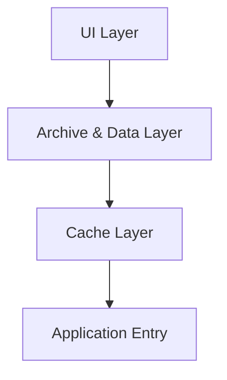

# Architecture Specification

> Generated by openlore v1.2.0 on 2026-10-07 14:44

## Purpose

This document describes the architectural patterns and structure of the system.

## Architecture Style

Monolithic desktop GUI architecture: rust-based native desktop application structured into distinct
presentation (UI), archive processing (CBZ/filesystem), and resource management (cache) layers.

## Requirements

### Requirement: LayeredArchitecture

The system SHALL maintain separation between:
- UI Layer (Manages top-level window controls, user navigation, scroll handling, reading mode layouts, and page visual presentation widgets.)
- Archive & Data Layer (Discovers CBZ archives across filesystem directories, extracts dimensions, decompresses archives, and decodes images.)
- Cache Layer (Manages in-memory decoded page textures and enforces memory limits via distance-from-viewport eviction policies.)
- Application Entry (Initializes the application runtime and launches the primary desktop window.)

#### Scenario: LayerSeparation
- **GIVEN** a request from the presentation layer
- **WHEN** business logic is needed
- **THEN** the presentation layer delegates to the business layer
- **AND** direct database access from presentation is prohibited

### Requirement: SecurityModel

The system SHALL implement security via: Local client security context relying on host OS user permissions for filesystem access; no authentication, authorization, or network access controls observed.

#### Scenario: AuthenticatedAccess
- **GIVEN** an unauthenticated request
- **WHEN** accessing protected resources
- **THEN** access is denied

## System Diagram

## Layer Structure

### UI Layer

**Purpose**: Manages top-level window controls, user navigation, scroll handling, reading mode layouts, and page visual presentation widgets.
**Location**: `src/ui/window.rs (ManhwaWindow), src/ui/reader.rs (ReaderView), src/ui/page_widget.rs (PageWidget), ChapterBanner, ReadingMode`

### Archive & Data Layer

**Purpose**: Discovers CBZ archives across filesystem directories, extracts dimensions, decompresses archives, and decodes images.
**Location**: `src/cbz/archive.rs (CbzArchive), DirectorySeries`

### Cache Layer

**Purpose**: Manages in-memory decoded page textures and enforces memory limits via distance-from-viewport eviction policies.
**Location**: `MemoryManager`

### Application Entry

**Purpose**: Initializes the application runtime and launches the primary desktop window.
**Location**: `src/main.rs`

## Data Flow

User interaction/scroll event → Window/ReaderView dispatches viewport requests →
DirectorySeries/CbzArchive reads and decompresses CBZ image data from filesystem → MemoryManager
caches decoded textures with eviction management → PageWidget renders texture to screen

## External Integrations

| System | Purpose |
|--------|---------|
| Local File System (CBZ archive discovery, file decompression, and reading) | External integration |
| Desktop Windowing/Display Server (native GUI and input events) | External integration |
